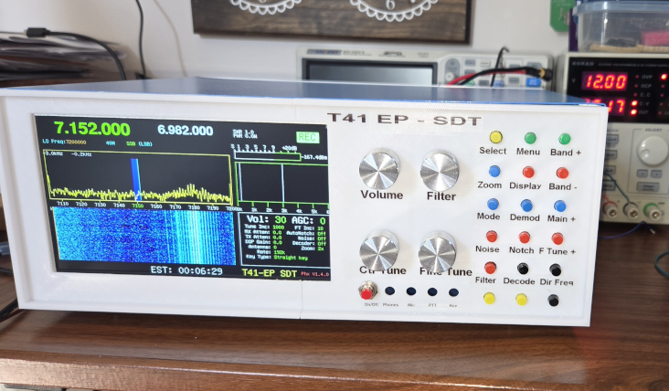
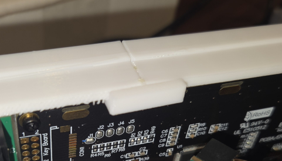
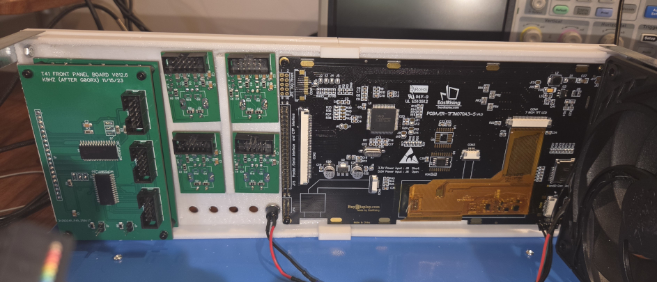

# V12_Front_Panel_7_Inch_Zulkit

Front Panel for V12 with 7 Inch display for the T41-EP SDT software defined transceiver with the Zulkit 12.6x10.6x4.7inch (320x268x120mm) case

## Parts
Case https://www.amazon.com/Zulkit-Electronic-Enclosures-Enclosure-Preventive/dp/B08BS243RC (12.6x10.6x4.7)
Glue https://www.amazon.com/dp/B0CBSGWZRW
Inserts: https://www.amazon.com/gp/product/B0FWCG2K1F (300+6Pcs Brass Threaded Inserts M2 M2.5 M3 M4 M5 for 3D Printing)

## 3D prints

I used a Bambu Lab P1S.   Nothing to special, but be sure to
* Enable support (Support Tab)
* Top Z distance - 0.3 mm (Support Tab)
* Brim type - Outer brim only (Others Tab)

I used white PETG (Sunlu), but PLA should work too.

Orientation should be the outside of the panel should be top up for cleaner prints

## Building Steps

1. 3D print:
	* V12_Front_Panel_7_inch_Zulkit-Slice.left
	* V12_Front_Panel_7_inch_Zulkit-Slice.right
	* 2x V12_Front_Panel_7_inch_Zulkit-GlueMount.left
2. Break off all the nasty tree supports
3. Glue the 2 halves together by gluing the 2 Glue mounts to the inside of insides of the two halves to they overlap both pieces.  (See Pic).  I use KraftProtz 3D Printing Super Glue (Amazon).  I had to clamp it for about 15 Minutes.

4. I used M2.5 (H2.5) heated inserts (Length 2.5, Outer Width 3.5, Smooth Width 3.04)  for mounting the keypad and display.  A kit full of these is only $9 on Amazon.  If you don't want to use these, just drill the holes through and use screws and nuts for mounting.  After inserting the inserts, take a M2.5 screw and make sure they can be screwed into each hole, just in case a little plastic melting on the thread.  Much easier to do it now while its not in the case.
5. Put labels on the case if you want.  I used clear DYMO labels.  However, if you don't don't spray paint a clear code on them.  It fades and yellows the labels.   If you have laser print labels, use them and then paint a clear coat to keep them from pealing off later.
6. Take the lid off the Zulkit case and then remove the entire front panel.
7. Put the the new panel on and make sure the screws and nuts are tightened.  This is very difficult to do once the parts are mounted.
8. Mount all the front panel boards.  This is a little tricky but it does work. 

Enjoy!
